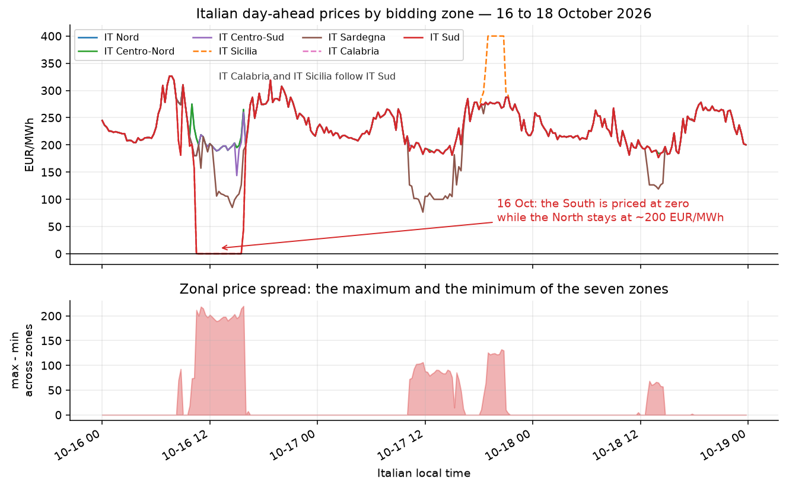
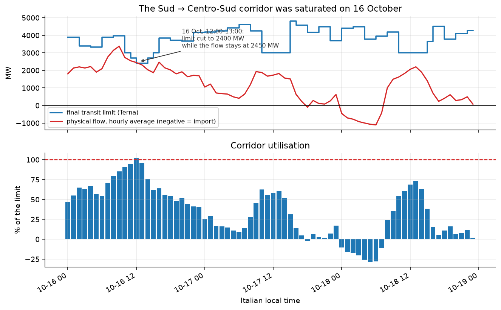
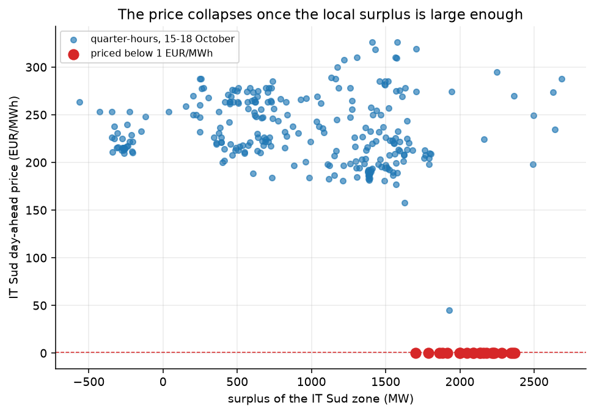
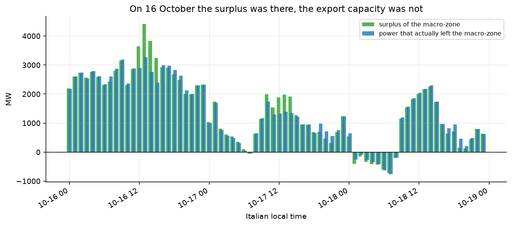

# Perché il prezzo del mercato del giorno prima è andato a zero nel Sud Italia il 16 ottobre 2026?

**In sintesi:** perché il mezzogiorno del 16 ottobre il Sud Italia era in surplus
per circa 3,6 GW, e la potenza non aveva dove andare: il corridoio Sud → Centro-Sud
girava al **92 % del limite di transito di Terna** (104–113 % in alcuni quarti d'ora),
il collegamento da 500 MW con la Grecia era al **100 %**, e la terza via d'uscita,
Malta, è un collegamento da 225 MW. Proprio quando sole e vento producevano 7,0 GW in
una zona che poteva esportarne solo 2,8 GW, il surplus non poteva uscire, quindi
l'unità marginale del Sud era energia gratis e il prezzo zonale è sceso al minimo di
mercato: **0,00 EUR/MWh per 21 quarti d'ora consecutivi (10:30 – 15:30, ora
italiana)**, mentre nello stesso momento il resto d'Italia valeva circa 199 EUR/MWh.

| | |
|---|---|
| **Evento** | venerdì 16 ottobre 2026, mercato del giorno prima (MGP) |
| **Zone interessate** | IT Sud, IT Calabria, IT Sicilia |
| **Durata** | 21 quarti d'ora (10:30 → 15:30 CEST), di cui 18 a esattamente 0,00 EUR/MWh |
| **Resto d'Italia, stesso mezzogiorno** | IT Nord / Centro-Nord / Centro-Sud ≈ 198,90 EUR/MWh |
| **Surplus del Sud (11:00–15:00)** | +3 645 MW (solare 4 242 MW + eolico 2 790 MW su un carico di 4 530 MW) |
| **Utilizzo del corridoio** | Sud → Centro-Sud: 2 338 MW contro un limite di 2 550 MW (92 %); Sud → Grecia: 414 MW contro un limite di 500 MW (83 %) |
| **Potenza che non poteva uscire** | ≈ 815 MW (surplus 3 645 MW − esportazioni 2 830 MW) |
| **Controllo** | Grecia 11,00, Francia 179,33, Austria 192,09, Slovenia 187,36 EUR/MWh (11:00–15:00) |

Tutto ciò che segue è riproducibile dai file CSV in [`data/`](data) con
`python src/run.py`. Ogni numero di questa pagina viene stampato da quello script.



---

## 1. L'evento, quarto d'ora per quarto d'ora

Il prezzo non è sceso gradualmente: è crollato in un solo quarto d'ora, mentre
l'utilizzo del corridoio era ancora sotto il 95 %, ed è risalito solo quando il
surplus era tornato ad essere ciò che il corridoio poteva trasportare.

| ora | prezzo IT Sud (EUR/MWh) | surplus Sud+Calabria+Sicilia (MW) | flusso sul corridoio (MW) | limite (MW) | utilizzo |
|------|------:|------:|------:|------:|------:|
| 09:00 | 310,39 | 3 150 | 3 515 | 3 967 | 89 % |
| 09:45 | 197,80 | 2 909 | 3 299 | 3 967 | 83 % |
| 10:00 | 201,23 | 2 317 | 2 743 | 3 000 | 91 % |
| 10:15 | 157,50 | 2 198 | 2 627 | 3 000 | 88 % |
| **10:30** | **0,10** | 2 307 | 2 712 | 3 000 | 90 % |
| **10:45** | **0,00** | 2 464 | 2 856 | 3 000 | 95 % |
| 11:00 | 0,04 | 2 856 | 2 611 | 2 700 | 97 % |
| 11:30 | 0,00 | 2 817 | 2 578 | 2 700 | 96 % |
| 12:00 | 0,02 | 3 639 | 2 346 | 2 400 | 98 % |
| 12:30 | 0,00 | 4 139 | 2 487 | 2 400 | 104 % |
| **13:00** | **0,00** | **4 417** | 2 711 | 2 400 | **113 %** |
| 14:00 | 0,00 | 3 832 | 2 181 | 2 700 | 81 % |
| 15:00 | 0,00 | 3 240 | 1 778 | 3 000 | 59 % |
| 15:45 | 45,00 | 2 444 | 1 817 | 3 000 | 61 % |
| 16:00 | 198,00 | 2 926 | 2 408 | 3 854 | 62 % |

Due cose accadono il 16 ottobre fra le 10:30 e le 11:00:

* **Terna taglia il limite di transito del corridoio Sud → Centro-Sud** da 3 000 MW
  a 2 700 MW e poi a **2 400 MW** per la finestra 12:00–14:00, cioè proprio nelle
  ore di massima produzione solare.
* Il flusso fisico non scende di conseguenza: resta a 2 300–2 700 MW, cioè **al
  limite o oltre** (fino al 113 % alle 13:00).

Il corridoio è saturo, il surplus non può essere esportato e il prezzo della zona
di mercato meridionale va a zero. Alle 16:00 Terna riporta il limite a 3 854 MW, il
corridoio smette di essere il vincolo e il prezzo torna al livello nazionale
(198,00 EUR/MWh) in un solo quarto d'ora.



## 2. Il meccanismo, in quattro passi

### 2.1 Un pomeriggio di sole e vento al Sud

Fra le 11:00 e le 15:00 del 16 ottobre le tre zone meridionali (Sud, Calabria,
Sicilia) hanno prodotto **8 175 MW** contro un carico di **4 530 MW**:

| MW (media 11:00–15:00) | solare | eolico | idro | gas | altro | generazione | carico | **surplus** |
|---|---:|---:|---:|---:|---:|---:|---:|---:|
| **16 ottobre** | 4 242 | **2 790** | 470 | 371 | 304 | 8 175 | 4 530 | **+3 645** |
| 17 ottobre | 4 200 | **253** | 292 | 919 | 282 | 5 947 | 4 151 | +1 796 |
| 18 ottobre | 4 394 | 227 | 28 | 492 | 275 | 5 417 | 3 372 | +2 045 |

Il 16 è l'unico dei tre giorni con vento vero (**2 790 MW contro i 253 MW del giorno
dopo**); il solare era praticamente identico. Per questo il surplus del 16 era
circa il doppio di quello del 17.

### 2.2 Tre confini, e due erano già pieni

La macrozona meridionale può esportare attraverso tre soli confini. Terna dichiara
per ciascuno un limite di transito, e il 16 ottobre due dei tre erano a quel
limite:

| confine | limite dichiarato da Terna (MW) | flusso, 16 ott, media 11:00–15:00 (MW) | utilizzo, medio | utilizzo, max |
|---|---:|---:|---:|---:|
| IT Sud → IT Centro-Sud | 2 400 – 2 700 | **2 338** | 92 % | **113 %** |
| IT Sud → Grecia | **500** | 414 | 83 % | **100 %** |
| IT Sicilia → Malta | 225 | 78 | 34 % | 42 % |
| **esportazioni totali** | 3 125 – 3 425 | **2 830** | | |
| surplus | | 3 645 | | |
| **differenza (non esportabile)** | | **815** | | |

L'esportazione verso la Grecia è ciò che un grafico a un solo corridoio nasconde:
l'interconnessione con la Grecia ha una capacità di 500 MW, e il 16 ottobre ha
portato in media 414 MW arrivando a 502 MW alle 14:00, cioè al limite. Il surplus
non è rimasto lontano dalla Grecia; ha riempito anche la Grecia. L'unica
interfaccia con spazio era Malta, un collegamento da 225 MW: da lì potevano uscire
al massimo circa 130 MW in più. Sulla finestra di mezzogiorno le tre interfacce
potevano portare al massimo 3 125 MW — il limite del corridoio è al suo minimo
proprio a mezzogiorno — contro un surplus di 3 645 MW: **almeno 520 MW non
potevano uscire comunque**.

Sicilia e Calabria sono a loro volta staccate dalla penisola: sul confine Sud ↔
Calabria ENTSO-E registra due dichiarazioni di indisponibilità (A78) che coprono
tutto l'evento, una per 2 000 MAW di capacità disponibile (1–24 ottobre) e una per
**600 MAW** (12–23 ottobre). Il flusso netto su quel confine è stato di 536 MW dalla
Calabria verso il Sud il 16, e si è invertito il giorno dopo (210 MW dal Sud verso la
Calabria): il surplus non poteva nemmeno essere ridistribuito dentro la macrozona.

### 2.3 Il limite di transito è ciò che l'asta del giorno prima ha usato

Terna calcola la potenza massima che può scorrere fra due zone di mercato
mantenendo la sicurezza della rete secondo il criterio n-1; GME usa quei valori
come dato dell'asta del giorno prima. I *limiti definitivi* pubblicati per il
corridoio Sud → Centro-Sud erano:

| 16 ottobre 2026 | 08:00 | 09:00 | 10:00 | 11:00 | 12:00 | 13:00 | 14:00 | 15:00 | 16:00 |
|---|---:|---:|---:|---:|---:|---:|---:|---:|---:|
| limite (MW) | 3 967 | 3 967 | 3 000 | 2 700 | **2 400** | **2 400** | 2 700 | 3 000 | 3 854 |

Il limite è stato tagliato esattamente sul picco solare, e il flusso fisico ha
tenuto il corridoio al 92 % del limite in media sulla finestra di mezzogiorno,
sopra il 100 % per tre quarti d'ora consecutivi.

### 2.4 In un mercato zonale paga ciò che non si sposta

In un mercato zonale il prezzo lo determina l'unità marginale *di quella zona*.
Quando la zona è in surplus più di quanto possa esportare, l'unità marginale è il
surplus stesso: il suo costo opportunistico è zero, e quindi il prezzo zonale va
al minimo. La soglia si vede chiaramente nei dati: sui giorni analizzati il prezzo
di IT Sud non è mai sceso sotto 157 EUR/MWh finché il surplus locale è rimasto sotto
1 700 MW; i 21 quarti d'ora a prezzo zero sono esattamente quelli con surplus fra
1 703 e 2 370 MW; e la media dei quarti d'ora con surplus sopra 2 000 MW è stata di
88,36 EUR/MWh (minimo 0,00) contro 215–244 EUR/MWh nelle fasce più basse.





## 3. Perché non è stata un'altra causa

**Non è stato un crollo della domanda.** Il carico del Sud il 16 (4 530 MW) era
*più alto* che il 17 (4 151 MW) e del 18 (3 372 MW). La domanda era normale; è
stata l'offerta a essere insolitamente alta.

**Non è stato un evento europeo.** I paesi vicini erano prezzati normalmente nello
stesso mezzo giorno (medie 11:00–15:00):

| EUR/MWh (16 ott, 11:00–15:00) | IT Sud | Grecia | Francia | Austria | Slovenia | Svizzera | Montenegro |
|---|---:|---:|---:|---:|---:|---:|---:|
| | **0,00** | 11,00 | 179,33 | 192,09 | 187,36 | 192,76 | 160,51 |

L'unico mercato altro che non era sul livello abituale era la Grecia (11,00
EUR/MWh); Francia, Austria, Slovenia e Svizzera — paesi collegati elettricamente
alle zone settentrionali italiane — erano sui normali ~190 EUR/MWh. Qualunque cosa
sia successa, è successa dentro il Sud Italia.

**Il giorno dopo la meccanica si conferma.** Il 17 ottobre la produzione solare era
la stessa (4 200 MW), il vento era sparito (253 MW), il surplus era dimezzato
(1 796 MW), il limite del corridoio era tornato a 3 000 MW e l'utilizzo era sceso al
57 %. Il prezzo è tornato a 191,38 EUR/MWh. Il 18 ottobre: utilizzo 67 %, prezzo
193,11 EUR/MWh. Stesso meteo, stesso corridoio, nessun crollo.

| | 16 ott | 17 ott | 18 ott |
|---|---:|---:|---:|
| limite del corridoio, 11:00–15:00 (MW) | 2 550 | 3 000 | 3 000 |
| flusso fisico (MW) | 2 338 | 1 697 | 1 996 |
| utilizzo | **92 %** | 57 % | 67 % |
| prezzo IT Sud (EUR/MWh) | **0,00** | 191,38 | 193,11 |

## 4. La stessa rete, il problema opposto

Una settimana prima gli stessi vincoli di trasmissione hanno prodotto il risultato
opposto. La sera del **17 ottobre, fra le 19:00 e le 20:45, la Sicilia è stata
prezzata a esattamente 400,00 EUR/MWh per 8 quarti d'ora consecutivi**, mentre ogni
altra zona italiana era a ~275 EUR/MWh. Il numero tondo è compatibile con un tetto
applicato alla sub-zona siciliana: con i collegamenti interni verso la Calabria e
verso la penisola congestionati nella direzione opposta, l'isola ha dovuto pagare
il proprio picco serale.

I due eventi sono la stessa lezione da due estremi opposti: **in un mercato zonale
il prezzo lo decide il vincolo di trasmissione, non il saldo del Paese.**

## 5. Avvertenze e note metodologiche

* **Mercato del giorno prima, non mercato realtime.** L'analisi riguarda l'asta MGP,
  che chiude il giorno prima a mezzogiorno. Nulla qui descrive il mercato
  infragiornaliero.
* **ENTSO-E omette i valori ripetuti.** Con `curveType A03` un quarto d'ora viene
  scritto solo quando il valore cambia; le posizioni omesse ripetono la precedente.
  `src/entsoe.py` ricostruisce le serie. Senza quel passaggio ogni timestamp si
  sposta e ogni media viene falsata (in questo dataset, 10–29 quarti d'ora per zona
  sono stati ricostruiti).
* **Direzione dei flussi.** ENTSO-E pubblica un documento per direzione e ognuno
  riporta un valore solo mentre il flusso procede davvero in quella direzione; il
  flusso netto è `f(avanti) − f(indietro)`. Il confine Grecia è pubblicato con
  risoluzione oraria, quelli interni italiani e Sicilia ↔ Malta a 15 minuti.
* **Il limite di transito è un dato orario** e vale per tutti i quarti d'ora
  dell'ora; il confronto con il flusso fisico è quindi fatto tra il limite orario e
  la media oraria del flusso (il picco di quarto d'ora della stessa ora è riportato
  separatamente).
* **Le due dichiarazioni A78 si sovrappongono** (2 000 MAW e 600 MAW di capacità
  disponibile sullo stesso confine, con finestre di validità sovrapposte). I dati
  pubblicati non permettono di stabilire quale valga; ciò che è certo è che la
  capacità disponibile su quel confine era dichiarata ben al di sotto dei 1 750 MW
  di flusso osservati il 15 ottobre.
* **Nessuna pretesa sulla causa dell'intervento.** I documenti A78 hanno il campo
  motivo vuoto: l'analisi può dire che la capacità era ridotta, non perché.

## 6. Come riprodurlo

```bash
git clone https://github.com/davcac/entsoe-south-italy-zero-price.git
cd entsoe-south-italy-zero-price
python -m venv .venv && .venv\Scripts\activate      # oppure: source .venv/bin/activate
pip install -r requirements.txt

python src/run.py          # stampa il report e ricostruisce i grafici
```

`src/run.py` legge solo i CSV della cartella `data/`: non serve alcuna chiave API.

Per ricostruire il dataset da scaricamenti freschi:

```bash
export ENTSOE_TOKEN=<tuo token ENTSO-E>              # https://transparency.entsoe.eu
python src/download.py --out raw --start 2026-10-16 --end 2026-10-19
python src/build_dataset.py --raw raw --out data
```

I documenti grezzi non sono versionati (sono pesanti); il dataset derivato sì, così
che ogni grafico e ogni numero di questa pagina siano verificabili senza
credenziali.

### Il codice

| file | cosa fa |
|---|---|
| `src/entsoe.py` | client della piattaforma di trasparenza ENTSO-E: prezzi (A44), carico (A65), generazione (A75), flussi transfrontalieri (A11), indisponibilità (A78). Gestisce le curve rade `A03` e non stampa mai il token. |
| `src/download.py` | scarica tutti i documenti grezzi (ENTSO-E + Terna) in `raw/`. |
| `src/terna_limits.py` | limiti di transito di Terna (definitivi / provvisori / margini) per le cinque interfacce della macrozona, dal portale pubblico - senza chiave API. |
| `src/build_dataset.py` | trasforma XML/XLSX grezzi nei sei CSV di `data/`, incluso il flusso lordo di ogni direzione di confine. |
| `src/analysis.py` | la diagnostica: finestra a prezzo zero, mix generativo, utilizzo del corridoio, bilancio delle esportazioni, soglia prezzo/surplus, gruppo di controllo. Stampa ogni numero citato sopra. |
| `src/figures.py` | i cinque grafici. |

### Il quaderno di lavoro originale

In **radice** ci sono i sedici script del primo giro esplorativo (`01_api_basics_ecb.py`
→ `16_limiti_transito.py`), da "come si legge una chiave API senza stamparla" al
"disegno il limite di transito sopra il flusso fisico". I loro output sono in
[`log/`](log): i report di testo (che si leggono senza eseguire nulla), i dati
grezzi e i grafici.

La riscrittura in `src/` è venuta dopo, quando ho voluto che il lavoro fosse
riproducibile e pubblicabile: un comando, nessuna chiave API, ogni numero di
questo file stampato dal codice che lo ha prodotto. Il quaderno resta com'è,
perché mostra come la domanda è stata davvero indagata — quali script fallivano,
che cosa rispondeva ENTSO-E, in che ordine — e i numeri che ha stampato sono
quelli verificati uno a uno contro `src/analysis.py`.

Lo script 15 è stato corretto in seguito: ora legge il dataset pubblicato in `data/`
invece dei documenti grezzi di ENTSO-E, così chi clona il repository può rigenerare
il suo grafico con `python 15_grafici.py`. La correzione conta: disegnando solo il
corridoio Sud → Centro-Sud contro il surplus della macrozona il grafico mostrava
1 307 MW di potenza che non poteva uscire, mentre il numero giusto è 815 MW: mancavano
Grecia e Malta.

```
├── 01…16 script            il quaderno, in ordine
├── src/                    la pipeline riscritta, riproducibile
├── data/                   i CSV derivati (prezzi, carico, generazione, flussi, limiti)
├── figures/                i 5 grafici dell'analisi
└── log/                    gli output del quaderno
```

### Come si usa

```bash
pip install -r requirements.txt
python src/run.py          # stampa il report e ricostruisce i grafici
```

`src/run.py` legge solo i CSV di `data/`: **non serve alcuna chiave API**.
Per ricostruire il dataset da scaricamenti freschi:

```bash
export ENTSOE_TOKEN=<tuo token ENTSO-E>              # https://transparency.entsoe.eu
python src/download.py --out raw --start 2026-10-16 --end 2026-10-19
python src/build_dataset.py --raw raw --out data
```

Gli script del quaderno, invece, sono quelli che hai usato tu: girano su Windows,
leggono il token dal volume cifrato montato su `A:` e scrivono ogni output in
`log/` con la data e l'ora nel nome.

## 7. Fonti

| dato | fonte | licenza |
|---|---|---|
| prezzi day-ahead, carico, generazione, flussi, indisponibilità | [piattaforma di trasparenza ENTSO-E](https://transparency.entsoe.eu/) | condizioni d'uso della piattaforma (gratuite, non commerciali) |
| limiti di transito fra zone di mercato | [portale dati Terna](https://dati.terna.it/download-center) — "Limiti di transito tra zone di mercato" | open data pubblico |

Dati scaricati il 19 ottobre 2026 per i giorni di consegna 16–18 ottobre 2026
(15 ottobre per carico, generazione e flussi). ENTSO-E è la fonte primaria; Terna
pubblica i limiti che GME usa nell'asta del giorno prima.

## 8. Autore

**Davide Cacciari** — economia e mercati dell'energia.
[LinkedIn](https://www.linkedin.com/in/davide-cacciari) · [GitHub](https://github.com/davcac)

Licenza MIT — vedi [LICENSE](LICENSE).
