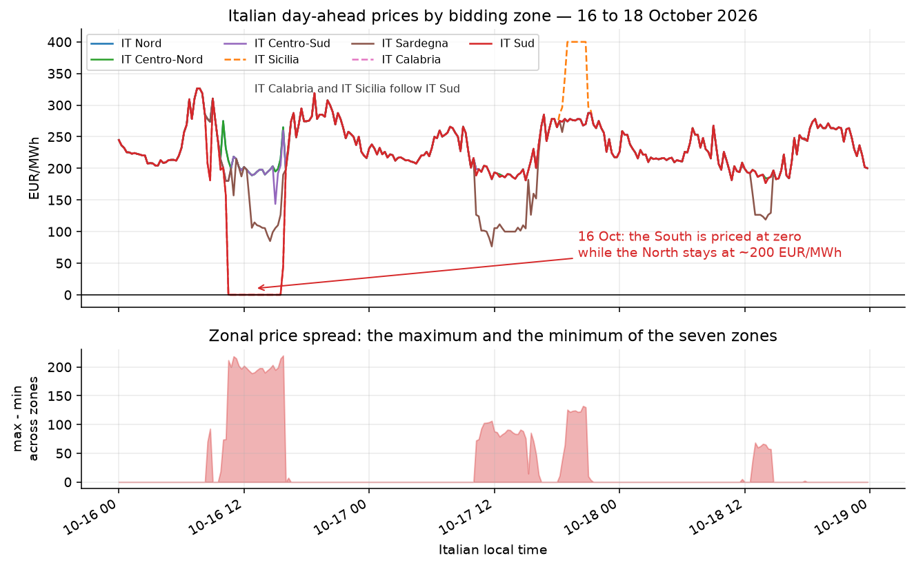
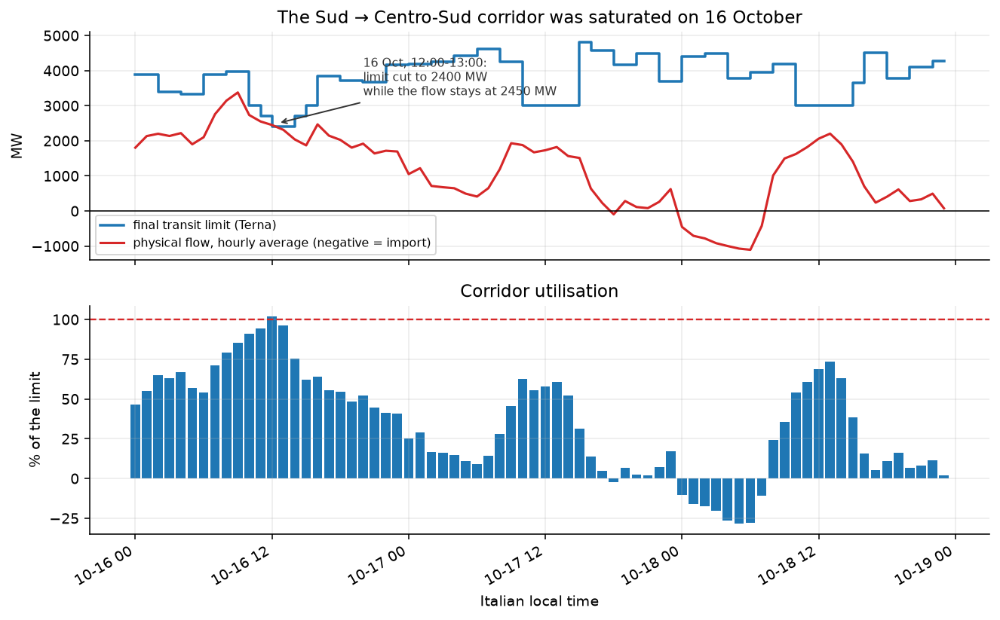
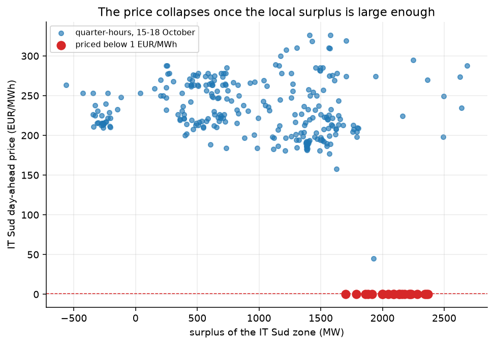
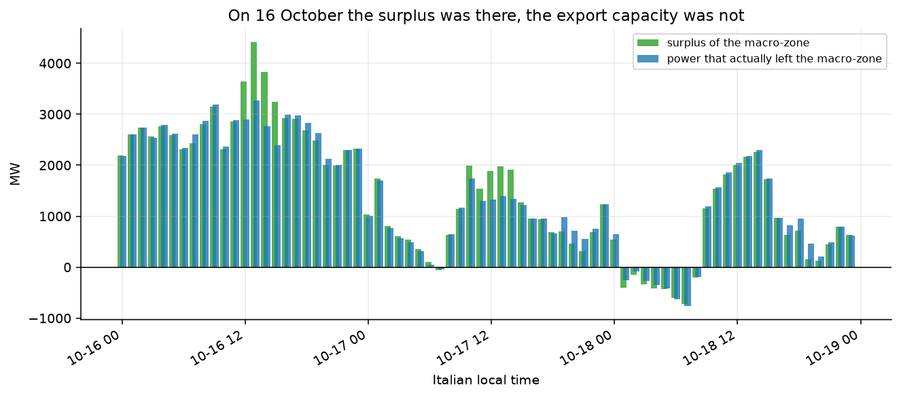

# Why did the Italian day-ahead price go to zero in the South on 16 October 2026?

**Short answer:** because Southern Italy was long by ~3.6 GW at midday, and the power
had nowhere to go: the Sud → Centro-Sud corridor was running at **92 % of its Terna
transit limit** (105–113 % in some quarter-hours), the 500 MW link to Greece was at
**100 %**, and the third way out, Malta, is a 225 MW link. Exactly when the sun and
the wind were producing 7.0 GW in a zone that could only export 2.8 GW, the surplus
could not leave, so the marginal unit in the South was free energy, and the zonal
price fell to the market floor: **0.00 EUR/MWh for 21 consecutive quarter-hours
(10:30 – 15:30, Italian time)**, while the rest of Italy was priced at ~199 EUR/MWh
at the same moment.

| | |
|---|---|
| **Event** | Friday 16 October 2026, Italian day-ahead market (MGP) |
| **Affected zones** | IT Sud, IT Calabria, IT Sicilia |
| **Duration** | 21 quarter-hours (10:30 → 15:30 CEST), 17 of them at exactly 0.00 EUR/MWh |
| **Rest of Italy, same midday** | IT Nord / Centro-Nord / Centro-Sud ≈ 198.90 EUR/MWh |
| **Southern surplus (11:00–15:00)** | +3 645 MW (solar 4 242 MW + wind 2 790 MW against a load of 4 530 MW) |
| **Corridor utilisation** | Sud → Centro-Sud: 2 338 MW against a 2 550 MW limit (92 %); Sud → Greece: 414 MW against a 500 MW limit (83 %) |
| **Power that could not leave** | ≈ 815 MW (surplus 3 645 MW − exports 2 830 MW) |
| **Control group** | Greece 11.00, France 179.33, Austria 192.09, Slovenia 187.36 EUR/MWh (11:00–15:00) |

Everything below is reproducible from the CSV files in [`data/`](data) with
`python src/run.py`. Every number in this README is printed by that script.



---

## 1. The event, quarter-hour by quarter-hour

The price did not fall gradually: it collapsed in a single quarter-hour, while the
corridor utilisation was still below 95 %, and it recovered only when the surplus
had shrunk back to what the corridor could carry — and then fully, in the very
quarter-hour in which Terna restored the limit.

| time | IT Sud price (EUR/MWh) | surplus of Sud+Calabria+Sicilia (MW) | corridor flow (MW) | corridor limit (MW) | utilisation |
|------|------:|------:|------:|------:|------:|
| 09:00 | 310.39 | 3 150 | 3 515 | 3 967 | 89 % |
| 09:45 | 197.80 | 2 909 | 3 299 | 3 967 | 83 % |
| 10:00 | 201.23 | 2 317 | 2 743 | 3 000 | 91 % |
| 10:15 | 157.50 | 2 198 | 2 627 | 3 000 | 88 % |
| **10:30** | **0.10** | 2 307 | 2 712 | 3 000 | 90 % |
| **10:45** | **0.00** | 2 464 | 2 856 | 3 000 | 95 % |
| 11:00 | 0.04 | 2 856 | 2 611 | 2 700 | 97 % |
| 11:30 | 0.00 | 2 817 | 2 578 | 2 700 | 96 % |
| 12:00 | 0.02 | 3 639 | 2 346 | 2 400 | 98 % |
| 12:30 | 0.00 | 4 139 | 2 487 | 2 400 | 104 % |
| **13:00** | **0.00** | **4 417** | 2 711 | 2 400 | **113 %** |
| 14:00 | 0.00 | 3 832 | 2 181 | 2 700 | 81 % |
| 15:00 | 0.00 | 3 240 | 1 778 | 3 000 | 59 % |
| 15:45 | 45.00 | 2 444 | 1 817 | 3 000 | 61 % |
| 16:00 | 198.00 | 2 926 | 2 408 | 3 854 | 62 % |

Two things happen at 10:30 and 11:00 on 16 October:

* **Terna cuts the transit limit on the Sud → Centro-Sud corridor** from 3 000 MW to
  2 700 MW and then to **2 400 MW** for the 12:00–14:00 window — the hours with the
  highest solar output.
* The physical flow does not fall accordingly: it stays at 2 300–2 700 MW, i.e. **at
  or above the limit** (up to 113 % at 13:00).

The corridor is saturated, the surplus cannot be exported, and the price in the
southern bidding zone drops to the floor. At 16:00 Terna raises the limit back to
3 854 MW, the corridor stops being the binding constraint and the price returns to
the national level (198.00 EUR/MWh) in a single quarter-hour.



## 2. The mechanism, in four steps

### 2.1 A sunny, windy afternoon in the South

Between 11:00 and 15:00 on 16 October the three southern zones (Sud, Calabria,
Sicilia) produced **8 175 MW** against a load of **4 530 MW**:

| MW (11:00–15:00 average) | solar | wind | hydro | gas | other | total generation | load | **surplus** |
|---|---:|---:|---:|---:|---:|---:|---:|---:|
| **16 October** | 4 242 | **2 790** | 470 | 371 | 304 | 8 175 | 4 530 | **+3 645** |
| 17 October | 4 200 | **253** | 292 | 919 | 282 | 5 947 | 4 151 | +1 796 |
| 18 October | 4 394 | 227 | 28 | 492 | 275 | 5 417 | 3 372 | +2 045 |

The 16th is the only day of the three with meaningful wind (**2 790 MW against 253 MW
the day after**). Solar was basically identical on both days. The surplus on the 16th
was therefore about twice the surplus on the 17th.

### 2.2 Three borders, and two of them were already full

The southern macro-zone can export through three borders only. Terna declares a
transit limit for each of them, and on 16 October two of the three were at that
limit:

| border | limit declared by Terna (MW) | flow, 16 Oct 11:00–15:00 avg (MW) | utilisation, avg | utilisation, max |
|---|---:|---:|---:|---:|
| IT Sud → IT Centro-Sud | 2 400 – 2 700 | **2 338** | 92 % | **113 %** |
| IT Sud → Greece | **500** | 414 | 83 % | **100 %** |
| IT Sicilia → Malta | 225 | 78 | 34 % | 42 % |
| **total exports** | 3 125 – 3 425 | **2 830** | | |
| surplus | | 3 645 | | |
| **difference (could not leave)** | | **815** | | |

The export to Greece is what a single-corridor chart hides: the interconnection
with Greece is rated at 500 MW, and on 16 October it carried 414 MW on average and
reached 502 MW at 14:00 — at the limit. The surplus did not stay away from
Greece; it filled Greece too. The only interface with room left was Malta, a
225 MW link: at most about 130 MW more could have left that way. Over the midday
window the three interfaces could carry at most 3 125 MW — the corridor limit is
at its lowest exactly at noon — against a surplus of 3 645 MW, so **at least
520 MW could not leave at all**.

Sicily and Calabria are also cut off from the mainland: on the Sud ↔ Calabria border
ENTSO-E records two outage declarations (A78) covering the whole event — one for
2 000 MAW of available capacity (1–24 October) and one for **600 MAW** (12–23 October).
The net flow on that border was 536 MW from Calabria towards the Sud on the 16th,
and it reversed the following day (210 MW from the Sud towards Calabria): the surplus
could not even be redistributed inside the macro-zone.

### 2.3 The corridor limit is what the day-ahead auction actually used

Terna computes the maximum power that may flow between two bidding zones while
keeping the grid secure under the n-1 criterion; GME takes those numbers as an
input of the day-ahead auction. The *final* limits published for the Sud →
Centro-Sud corridor were:

| 16 October 2026 | 08:00 | 09:00 | 10:00 | 11:00 | 12:00 | 13:00 | 14:00 | 15:00 | 16:00 |
|---|---:|---:|---:|---:|---:|---:|---:|---:|---:|
| limit (MW) | 3 967 | 3 967 | 3 000 | 2 700 | **2 400** | **2 400** | 2 700 | 3 000 | 3 854 |

The limit was cut exactly over the solar peak, and the physical flow kept the
corridor at 92 % of the limit on average over the midday window, above 100 % in
three consecutive quarter-hours.

### 2.4 A zonal market prices what cannot move

In a zonal market the price is set by the marginal unit *of that zone*. When the
zone is long by more than its export capacity, the marginal unit is the surplus
itself: its opportunity cost is zero, so the zonal price falls to the floor. The
threshold is clearly visible in the data — over the days analysed, the IT Sud price
never fell below 157 EUR/MWh while the local surplus stayed below 1 700 MW, the 21
zero-price quarter-hours are exactly the ones with a surplus between 1 703 and
2 370 MW, and the average price of the quarter-hours with a surplus above 2 000 MW
was 88.36 EUR/MWh (minimum 0.00) against 215–244 EUR/MWh in the lower bins.





## 3. Why it was not something else

**It was not a demand collapse.** The southern load on the 16th (4 530 MW) was
*higher* than on the 17th (4 151 MW) and on the 18th (3 372 MW). Demand was normal;
supply was unusually high.

**It was not a general European event.** The neighbouring countries were priced
normally on the same midday (11:00–15:00 averages):

| EUR/MWh (16 Oct, 11:00–15:00) | IT Sud | Greece | France | Austria | Slovenia | Switzerland | Montenegro |
|---|---:|---:|---:|---:|---:|---:|---:|
| | **0.00** | 11.00 | 179.33 | 192.09 | 187.36 | 192.76 | 160.51 |

Greece was the only other market that was not close to its usual level
(11.00 EUR/MWh), while France, Austria, Slovenia and Switzerland — countries
electrically connected to the northern Italian zones — were at their usual
~190 EUR/MWh. Whatever happened, it happened inside the Italian South.

**It was not a one-off within the week.** The same signature appears in the price
spread chart: the zonal spread (max − min across the seven zones) jumps from
~0 EUR/MWh to ~220 EUR/MWh during the event.

**The next day proves the mechanism.** On 17 October the solar output was the same
(4 200 MW), the wind had gone (253 MW), the surplus halved (1 796 MW), the corridor
limit was back to 3 000 MW and the utilisation fell to 57 %. The price returned to
191.38 EUR/MWh. On 18 October, utilisation 67 %, price 193.11 EUR/MWh. Same weather
pattern, same corridor, no collapse.

| | 16 Oct | 17 Oct | 18 Oct |
|---|---:|---:|---:|
| corridor limit, 11:00–15:00 (MW) | 2 550 | 3 000 | 3 000 |
| physical flow (MW) | 2 338 | 1 697 | 1 996 |
| utilisation | **92 %** | 57 % | 67 % |
| IT Sud price (EUR/MWh) | **0.00** | 191.38 | 193.11 |

## 4. The same grid, the opposite problem

One week earlier the same transmission constraints produced the opposite result.
On the evening of **17 October, between 19:00 and 20:45, Sicily was priced at
exactly 400.00 EUR/MWh for 8 consecutive quarter-hours** while every other Italian
zone was at ~275 EUR/MWh. The round number is consistent with a ceiling applied to
the Sicilian sub-zone: with the internal links to Calabria and to the mainland
congested in the opposite direction, the island had to pay for its evening peak.

Both events are the same lesson from opposite ends: **in a zonal market, the price
is decided by the transmission constraint, not by the balance of the country.**

## 5. Caveats and methodological notes

* **Day-ahead, not real time.** The analysis is on the MGP (day-ahead) auction, the
  market that clears the following day at noon. Nothing here describes the
  intraday market.
* **ENTSO-E omits repeated values.** With `curveType A03` a quarter-hour is written
  only when its value changes; the missing positions repeat the previous one.
  `src/entsoe.py` re-expands these series. Ignoring this shifts every timestamp and
  biases every average (in this dataset, 10–29 quarter-hours per zone had to be
  reconstructed).
* **Flow direction.** ENTSO-E publishes one document per direction and each one
  carries a value only while the flow actually runs that way; the net flow is
  `f(forward) − f(backward)`. The Greece border is published with an hourly
  resolution, the Italian internal borders and Sicily ↔ Malta at 15 minutes.
* **The transit limit is an hourly value** and is applied to every quarter-hour of
  that hour; the comparison with the physical flow is therefore made between the
  hourly limit and the hourly average of the flow (the peak quarter-hour of the
  same hour is reported separately).
* **The two A78 outage records overlap** (2 000 MAW and 600 MAW of available
  capacity on the same border, with overlapping validity windows). The published
  data does not allow to determine which one applies; what is certain is that the
  available capacity on that border was declared well below the 1 750 MW of flow
  observed on 15 October.
* **No claim on the cause of the outage itself.** The A78 documents carry an empty
  reason field, so this analysis can only state that the capacity was reduced, not
  why.

## 6. How to reproduce

```bash
git clone https://github.com/davcac/entsoe-south-italy-zero-price.git
cd entsoe-south-italy-zero-price
python -m venv .venv && .venv\Scripts\activate      # or: source .venv/bin/activate
pip install -r requirements.txt

python src/run.py          # prints the report and rebuilds the figures
```

`src/run.py` only reads the CSV dataset in `data/`: no API key is needed.

To rebuild the dataset from fresh downloads:

```bash
export ENTSOE_TOKEN=<your ENTSO-E API token>        # https://transparency.entsoe.eu
python src/download.py --out raw --start 2026-10-16 --end 2026-10-19
python src/build_dataset.py --raw raw --out data
```

The raw documents are not versioned (size); the derived dataset is, so that every
figure and every number in this README can be checked without credentials.

### The code

| file | what it does |
|---|---|
| `src/entsoe.py` | ENTSO-E Transparency Platform client: prices (A44), load (A65), generation (A75), cross-border flows (A11), grid outages (A78). Handles the sparse `A03` curves and never logs the token. |
| `src/download.py` | Fetches every raw document (ENTSO-E + Terna) into `raw/`. |
| `src/terna_limits.py` | Terna transit limits (final / forecast / margins) for the five interfaces of the macro-zone, from the public download centre - no API key. |
| `src/build_dataset.py` | Turns the raw XML/XLSX into the six CSV files in `data/`, including the gross flow of every border direction. |
| `src/analysis.py` | The diagnostics: zero-price window, generation mix, corridor utilisation, export balance, price-vs-surplus threshold, control group. Prints every number quoted above. |
| `src/figures.py` | The five charts. |

### The original working notebook

The sixteen scripts in the repository root (`01_api_basics_ecb.py` →
`16_limiti_transito.py`) are the first, exploratory round — from learning how to
read an API key without printing it to drawing the transit limit on top of the
physical flow. Their output — the text reports, the raw prices, the charts — is in
[`log/`](log).

The rewrite in `src/` came afterwards, when I wanted the work to be reproducible
and publishable: one command, no API key, every number in this README printed by
the code that produced it. The notebook stays as it is, because it shows how the
question was actually investigated — which scripts failed, what ENTSO-E answered
back, in what order — and the numbers it printed are the ones that were
cross-checked against `src/analysis.py`.

Script 15 was later corrected: it now reads the published dataset in `data/`
instead of the raw ENTSO-E documents, so anyone cloning the repository can
regenerate its chart with `python 15_grafici.py`. The correction matters — drawing
only the Sud → Centro-Sud corridor against the surplus of the macro-zone made the
chart show 1 307 MW of power that could not leave, while the real figure is
815 MW: Greece and Malta were missing.

```
├── 01…16 script            the notebook, in order
├── src/                    the rewritten, reproducible pipeline
├── data/                   the derived CSV files
├── figures/                the five charts
└── log/                    the notebook output
```

## 7. Sources

| data | source | licence |
|---|---|---|
| day-ahead prices, load, generation, flows, outages | [ENTSO-E Transparency Platform](https://transparency.entsoe.eu/) | ENTSO-E Transparency Platform terms of use (free, non-commercial) |
| transit limits between bidding zones | [Terna download centre](https://dati.terna.it/download-center) — "Limiti di transito tra zone di mercato" | public open data |

Data retrieved on 19 October 2026 for the delivery days 16–18 October 2026
(15 October for load, generation and flows). ENTSO-E is the primary source and
Terna publishes the limits GME uses in the day-ahead auction.

## 8. Author

**Davide Cacciari** — economics and energy markets.
[LinkedIn](https://www.linkedin.com/in/davide-cacciari) · [GitHub](https://github.com/davcac)

MIT licence — see [LICENSE](LICENSE).
